# Srimad Bhagavatam

A family and character map covering the figures in this repository. Names use plain Roman spelling. See the sources for Sanskrit forms and edition-specific readings.

Arrows run from parents to children. Solid lines without arrows join spouses. Labeled links mark siblings, foster or adoptive parents, lineage details, and story connections.

## Family and character map

```mermaid
flowchart TD
    subgraph Frame_Narrative["How the text was told"]
        Vyasa["Sage Veda Vyasa"]
        Narada["Devarishi Narada (Spiritual Guide)"]
        Shukadeva["Shukadeva Gosvami (Son of Vyasa)"]
        Parikshit_King["Parikshit (King and listener)"]
        Suta["Ugrashrava (Suta Gosvami)"]
        Shaunaka["Shaunaka (At Naimisharanya)"]
    end
    subgraph Cosmic_Origins["Early lineages"]
        Brahma["Lord Brahma"]
        Svayambhuva["Svayambhuva Manu"]
        Shatarupa["Shatarupa"]
        Priyavrata["King Priyavrata"]
        Uttanapada["King Uttanapada"]
        Suniti["Queen Suniti"]
        Suruchi["Queen Suruchi"]
        Dhruva["Dhruva (Dhruvaloka)"]
        Uttama["Uttama"]
        Daksha["Prajapati Daksha"]
        Sati["Goddess Sati"]
        Shiva["Lord Shiva (Rudra)"]
        Rishabhadeva["Rishabhadeva (Avatar)"]
        Jada_Bharata["Bharata (Later Jada Bharata)"]
        Prithu["King Prithu (Avatar)"]
        Prasuti["Prasuti"]
        Vena["Vena"]
    end
    subgraph Avatars_and_Bhakti["Avatars, devotees and the line of Diti"]
        Varaha["Varaha (Boar Avatar)"]
        Narasimha["Narasimha (Man-Lion)"]
        Vamana["Vamana (Dwarf Brahmana)"]
        Hiranyaksha["Hiranyaksha"]
        Hiranyakashipu["Hiranyakashipu"]
        Prahlada["Prahlada Maharaja"]
        Mahabali["King Bali (Mahabali)"]
        Gajendra["Gajendra (Elephant Devotee)"]
        Ambarisha["King Ambarisha"]
        Durvasa["Sage Durvasa"]
        Diti["Diti"]
        Kashyapa["Kashyapa"]
        Kayadhu["Kayadhu"]
        Virochana["Virochana"]
    end
    subgraph Vrishni_Dynasty["Yadu houses of Mathura and Gokula"]
        Surasena["Shura (Father of Vasudeva)"]
        Ugrasena["King Ugrasena (Mathura)"]
        Kamsa["Kamsa (Tyrant King)"]
        Vasudeva["Vasudeva (Anakadundubhi)"]
        Devaki["Devaki (Daughter of Devaka)"]
        Rohini["Rohini"]
        Nanda["Nanda Maharaja (Gokula)"]
        Yashoda["Yashoda Mayi"]
        Balarama["Balarama (Sankarshana)"]
        Krishna["Lord Sri Krishna (Svayam Bhagavan)"]
        Subhadra_Y["Subhadra"]
        Devaka["Devaka"]
        Ahuka["Ahuka"]
    end
    subgraph Vraja_Leela["Companions of Vrindavan"]
        Radha["Radha (Commentarial identification)"]
        Gopis["Gopis (Cowherd women)"]
        Gopas["Gopas (Cowherd boys)"]
        Uddhava["Uddhava (Krishna’s cousin and counselor)"]
    end
    subgraph Dvaraka_Leela["Queens and heirs of Dvaraka"]
        Rukmini["Rukmini (Princess of Vidarbha)"]
        Satyabhama["Satyabhama (Daughter of Satrajit)"]
        Jambavati["Jambavati (Daughter of Jambavan)"]
        Kalindi["Kalindi (Yamuna)"]
        Mitravinda["Mitravinda"]
        Nagnajiti["Nagnajiti (Satya)"]
        Bhadra["Bhadra"]
        Lakshmana_Q["Lakshmana (Queen of Dvaraka)"]
        Pradyumna["Pradyumna (Incarnation of Kama)"]
        Mayavati["Mayavati"]
        Aniruddha["Aniruddha"]
        Usha["Usha (Daughter of Bana)"]
        Samba["Samba"]
        Vajra["Vajra (Yadu heir)"]
        Rukmavati["Rukmavati (Daughter of Rukmi)"]
        Rochana["Rochana (Granddaughter of Rukmi)"]
    end
    subgraph Adversaries_Redeemed["Kings and adversaries"]
        Jarasandha["Jarasandha (Magadha)"]
        Shishupala["Shishupala (Chedi)"]
        Dantavakra["Dantavakra (Karusha)"]
        Banasura["Banasura (Thousand-Armed)"]
    end
    Vyasa --> Shukadeva
    Brahma --> Svayambhuva
    Svayambhuva --- Shatarupa
    Svayambhuva --> Priyavrata
    Svayambhuva --> Uttanapada
    Uttanapada --- Suniti
    Uttanapada --- Suruchi
    Suniti --> Dhruva
    Suruchi --> Uttama
    Daksha --> Sati
    Sati --- Shiva
    Varaha -. Slays .-> Hiranyaksha
    Narasimha -. Protects .-> Prahlada
    Narasimha -. Slays .-> Hiranyakashipu
    Vamana -. Subdues & Blesses .-> Mahabali
    Ambarisha -. Tested by .-> Durvasa
    Ugrasena --> Kamsa
    Surasena --> Vasudeva
    Vasudeva --- Devaki
    Vasudeva --- Rohini
    Nanda --- Yashoda
    Rohini --> Balarama
    Devaki --> Krishna
    Devaki --> Subhadra_Y
    Krishna -. Slays .-> Kamsa
    Krishna -. Reinstates .-> Ugrasena
    Krishna -. Inner Circle .-> Gopas
    Krishna -. Teaches the Uddhava Gita to .-> Uddhava
    Krishna --- Rukmini
    Krishna --- Satyabhama
    Krishna --- Jambavati
    Krishna --- Kalindi
    Krishna --- Mitravinda
    Krishna --- Nagnajiti
    Krishna --- Bhadra
    Krishna --- Lakshmana_Q
    Rukmini --> Pradyumna
    Pradyumna --- Mayavati
    Pradyumna --> Aniruddha
    Aniruddha --- Usha
    Jambavati --> Samba
    Aniruddha --> Vajra
    Krishna -. Slays .-> Shishupala
    Krishna -. Slays .-> Dantavakra
    Krishna -. Subdues .-> Banasura
    Narada -. Inspires .-> Vyasa
    Shukadeva -. Recites the Bhagavatam to .-> Parikshit_King
    Shukadeva -. Heard by .-> Suta
    Suta -. Retells the Bhagavatam to .-> Shaunaka
    Brahma --> Daksha
    Svayambhuva --> Prasuti
    Shatarupa --> Priyavrata
    Shatarupa --> Uttanapada
    Shatarupa --> Prasuti
    Prasuti --- Daksha
    Prasuti --> Sati
    Uttanapada --> Dhruva
    Uttanapada --> Uttama
    Rishabhadeva --> Jada_Bharata
    Vena -. Emerges from Vena .-> Prithu
    Diti --- Kashyapa
    Diti --> Hiranyaksha
    Diti --> Hiranyakashipu
    Kashyapa --> Hiranyaksha
    Kashyapa --> Hiranyakashipu
    Hiranyakashipu --- Kayadhu
    Hiranyakashipu --> Prahlada
    Kayadhu --> Prahlada
    Prahlada --> Virochana
    Virochana --> Mahabali
    Mahabali --> Banasura
    Ahuka --> Ugrasena
    Ahuka --> Devaka
    Devaka --> Devaki
    Vasudeva --> Krishna
    Vasudeva --> Balarama
    Vasudeva --> Subhadra_Y
    Devaki -. Embryo transferred to Rohini .-> Balarama
    Nanda -. Adoptive or foster parent .-> Krishna
    Yashoda -. Adoptive or foster parent .-> Krishna
    Krishna -. Beloved gopi in commentary .-> Radha
    Krishna -. Dances with .-> Gopis
    Radha -. Identified as the favored gopi .-> Gopis
    Krishna --> Pradyumna
    Krishna --> Samba
    Pradyumna --- Rukmavati
    Rukmavati --> Aniruddha
    Aniruddha --- Rochana
    Rochana --> Vajra
    Banasura --> Usha
    Jarasandha -. Attacks Mathura .-> Krishna
    Krishna -. Helps Bhima defeat .-> Jarasandha
```

## Text and naming notes

The Yadu genealogy follows Bhagavatam 9.24 for Subhadra and 10.90.37 for Vajra. Radha’s label reflects the commentary on 10.30.28. The verse itself describes a favored gopi without giving her proper name.

## Sources

- [Srimad Bhagavatam · Full text](https://vedabase.io/en/library/sb/)
- [Canto 4 · The houses of Manu and Dhruva](https://vedabase.io/en/library/sb/4/1/)
- [Canto 6 · Prahlada, Virochana, Bali and Bana](https://vedabase.io/en/library/sb/6/18/)
- [Canto 9 · The Yadu genealogy](https://vedabase.io/en/library/sb/9/24/)
- [Canto 10 · Krishna’s wives and Rukmavati](https://vedabase.io/en/library/sb/10/61/)
- [Canto 10 · Rochana and Vajra](https://vedabase.io/en/library/sb/10/90/37/)
- [Canto 10 · The favored gopi and the commentary on Radha](https://vedabase.io/en/library/sb/10/30/28/)
