# Mahabharata

A family and character map covering the figures in this repository. Names use plain Roman spelling. See the sources for Sanskrit forms and edition-specific readings.

Arrows run from parents to children. Solid lines without arrows join spouses. Labeled links mark siblings, foster or adoptive parents, lineage details, and story connections.

## Family and character map

```mermaid
flowchart TD
    subgraph Ancestry["Ancestors of the Kuru house"]
        Pratipa["Pratipa (Father of Shantanu)"]
        Sunanda["Sunanda (Mother of Shantanu)"]
        Shantanu["Shantanu (Father of Bhishma)"]
        Bahlika["Bahlika (King of Bahlika)"]
        Devapi["Devapi (Ascetic)"]
        Ganga["Goddess Ganga"]
        Satyavati["Satyavati (Matsyagandha)"]
        Parashara["Parashara (Sage)"]
        Somadatta["Somadatta"]
        Bhurishravas["Bhurishravas"]
    end
    subgraph Vyasa_Generation["Bhishma and Vyasa"]
        Bhishma["Bhishma (Devavrata)"]
        Vyasa["Sage Veda Vyasa"]
        Chitrangada["Chitrangada"]
        Vichitravirya["Vichitravirya"]
        Ambika["Ambika (Princess of Kashi)"]
        Ambalika["Ambalika (Princess of Kashi)"]
        Parishrami["Ambika’s attendant"]
    end
    subgraph Royal_House["The royal house of Hastinapura"]
        Dhritarashtra["Dhritarashtra (Kuru king)"]
        Pandu["Pandu (Kuru king)"]
        Vidura["Vidura (Dharmaraja Incarnate)"]
        Gandhari["Queen Gandhari"]
        Kunti["Queen Kunti (Pritha)"]
        Madri["Queen Madri"]
        Shakuni["Shakuni (Prince of Gandhara)"]
        Dharma["Dharma"]
        Vayu["Vayu"]
        Indra["Indra"]
        Ashvins["Ashvins (Divine twins)"]
    end
    subgraph Kaurava_Camp["Kauravas and allies"]
        Duryodhana["Duryodhana (Suyodhana)"]
        Dushasana["Dushasana"]
        Vikarna["Vikarna"]
        Dushala["Dushala (Daughter)"]
        Yuyutsu["Yuyutsu (Joined the Pandavas)"]
        Jayadratha["Jayadratha (King of Sindhu)"]
        Karna["Karna (Radheya / Angaraja)"]
        Shalya["Shalya (King of Madra)"]
        Ashwatthama["Ashwatthama"]
        YuyutsuMother["Vaishya woman (Mother of Yuyutsu)"]
        Surya["Surya (Sun deity)"]
        Adhiratha["Adhiratha (Charioteer)"]
        Radha["Radha (Karna’s foster mother)"]
    end
    subgraph Teachers_Gurus["Teachers of the Kuru princes"]
        Drona["Drona (Dronacharya)"]
        Kripi["Kripi"]
        Kripa["Kripa (Kripacharya)"]
    end
    subgraph Pandava_Camp["Pandavas and their families"]
        Yudhishthira["Yudhishthira (Dharmaraja)"]
        Bhima["Bhima (Vrikodara)"]
        Arjuna["Arjuna (Dhananjaya)"]
        Nakula["Nakula"]
        Sahadeva["Sahadeva"]
        Draupadi["Draupadi (Panchali)"]
        Subhadra["Subhadra (Sister of Krishna)"]
        Hidimbi["Hidimbi (Rakshasi)"]
        Ulupi["Ulupi (Naga Princess)"]
        Chitrangada_M["Chitrangada of Manipur"]
        Ghatotkacha["Ghatotkacha"]
        Abhimanyu["Abhimanyu"]
        Iravan["Iravan (Aravan)"]
        Babruvahana["Babruvahana"]
        Upapandavas["Upapandavas (Draupadi’s five sons)"]
        Prativindhya["Prativindhya"]
        Sutasoma["Sutasoma"]
        Shrutakarman["Shrutakarman"]
        Shatanika["Shatanika"]
        Shrutasena["Shrutasena"]
    end
    subgraph Next_Generation["Heirs of Abhimanyu"]
        Uttara["Uttaraa (Princess of Matsya)"]
        Parikshit["King Parikshit"]
        Janamejaya["Janamejaya (Snake sacrifice)"]
    end
    subgraph Key_Allies["Allies and royal houses"]
        Krishna["Lord Sri Krishna (Guide & Charioteer)"]
        Balarama["Lord Balarama"]
        Satyaki["Satyaki (Yuyudhana)"]
        Drupada["King Drupada (Panchala)"]
        Dhrishtadyumna["Dhrishtadyumna (Commander)"]
        Shikhandi["Shikhandi (Amba Reborn)"]
        Virata["King Virata (Matsya)"]
    end
    Pratipa --- Sunanda
    Pratipa --> Shantanu
    Pratipa --> Bahlika
    Pratipa --> Devapi
    Bahlika --> Somadatta
    Somadatta --> Bhurishravas
    Shantanu --- Ganga
    Shantanu --- Satyavati
    Ganga --> Bhishma
    Parashara --> Vyasa
    Satyavati --> Chitrangada
    Satyavati --> Vichitravirya
    Vichitravirya --- Ambika
    Vichitravirya --- Ambalika
    Vyasa -. Niyoga .-> Ambika
    Vyasa -. Niyoga .-> Ambalika
    Vyasa -. Niyoga .-> Parishrami
    Ambika --> Dhritarashtra
    Ambalika --> Pandu
    Parishrami --> Vidura
    Dhritarashtra --- Gandhari
    Pandu --- Kunti
    Pandu --- Madri
    Dhritarashtra --> Duryodhana
    Dhritarashtra --> Dushasana
    Dhritarashtra --> Vikarna
    Dhritarashtra --> Dushala
    Dhritarashtra --> Yuyutsu
    Dushala --- Jayadratha
    Drona --- Kripi
    Drona --> Ashwatthama
    Kunti --> Yudhishthira
    Kunti --> Bhima
    Kunti --> Arjuna
    Madri --> Nakula
    Madri --> Sahadeva
    Yudhishthira --- Draupadi
    Bhima --- Draupadi
    Arjuna --- Draupadi
    Nakula --- Draupadi
    Sahadeva --- Draupadi
    Bhima --- Hidimbi
    Arjuna --- Subhadra
    Arjuna --- Ulupi
    Arjuna --- Chitrangada_M
    Bhima --> Ghatotkacha
    Arjuna --> Abhimanyu
    Arjuna --> Iravan
    Arjuna --> Babruvahana
    Abhimanyu --- Uttara
    Uttara --> Parikshit
    Parikshit --> Janamejaya
    Virata --> Uttara
    Drupada --> Draupadi
    Drupada --> Dhrishtadyumna
    Drupada --> Shikhandi
    Drona -. Trained .-> Duryodhana
    Drona -. Trained .-> Arjuna
    Krishna -. Counsel & Gita .-> Arjuna
    Karna -. Loyal Ally .-> Duryodhana
    Sunanda --> Shantanu
    Sunanda --> Bahlika
    Sunanda --> Devapi
    Shantanu --> Bhishma
    Shantanu --> Chitrangada
    Shantanu --> Vichitravirya
    Satyavati --> Vyasa
    Vyasa --> Dhritarashtra
    Vyasa --> Pandu
    Vyasa --> Vidura
    Gandhari --> Duryodhana
    Gandhari --> Dushasana
    Gandhari --> Vikarna
    Gandhari --> Dushala
    YuyutsuMother --> Yuyutsu
    Kunti --> Karna
    Surya --> Karna
    Adhiratha --- Radha
    Adhiratha -. Adoptive or foster parent .-> Karna
    Radha -. Adoptive or foster parent .-> Karna
    Gandhari -. Siblings .- Shakuni
    Madri -. Siblings .- Shalya
    Kripi --> Ashwatthama
    Kripa -. Siblings .- Kripi
    Dharma --> Yudhishthira
    Vayu --> Bhima
    Indra --> Arjuna
    Ashvins --> Nakula
    Ashvins --> Sahadeva
    Pandu -. Recognized son .-> Yudhishthira
    Pandu -. Recognized son .-> Bhima
    Pandu -. Recognized son .-> Arjuna
    Pandu -. Recognized son .-> Nakula
    Pandu -. Recognized son .-> Sahadeva
    Hidimbi --> Ghatotkacha
    Subhadra --> Abhimanyu
    Ulupi --> Iravan
    Chitrangada_M --> Babruvahana
    Abhimanyu --> Parikshit
    Draupadi --> Prativindhya
    Draupadi --> Sutasoma
    Draupadi --> Shrutakarman
    Draupadi --> Shatanika
    Draupadi --> Shrutasena
    Yudhishthira --> Prativindhya
    Bhima --> Sutasoma
    Arjuna --> Shrutakarman
    Nakula --> Shatanika
    Sahadeva --> Shrutasena
    Upapandavas -. Includes .-> Prativindhya
    Upapandavas -. Includes .-> Sutasoma
    Upapandavas -. Includes .-> Shrutakarman
    Upapandavas -. Includes .-> Shatanika
    Upapandavas -. Includes .-> Shrutasena
    Krishna -. Siblings .- Balarama
    Krishna -. Siblings .- Subhadra
    Kripa -. Teaches the Kuru princes .-> Arjuna
    Krishna -. Allied with .-> Satyaki
    Dhrishtadyumna -. Commands his army .-> Yudhishthira
    Bhishma -. Leads his army first .-> Duryodhana
```

## Text and naming notes

The chart shows Vyasa’s biological paternity through niyoga and Pandu’s place in the Pandavas’ royal lineage. Ganguli’s Adi Parva calls Vidura’s mother Ambika’s attendant. Uttaraa (Uttarā) uses a doubled final vowel to distinguish Abhimanyu’s wife from her brother Uttara.

## Sources

- [Mahabharata · Adi Parva, Ganguli translation](https://www.ibiblio.org/sripedia/ebooks/mb/m01/index.html)
- [Adi Parva · Genealogy of the Kuru house](https://www.wisdomlib.org/hinduism/book/the-mahabharata-mohan/d/doc4088.html)
- [Adi Parva · Kuru figures and their births](https://www.ibiblio.org/sripedia/ebooks/mb/m01/m01068.htm)
- [Adi Parva · Abhimanyu and the sons of Draupadi](https://www.ibiblio.org/sripedia/ebooks/mb/m01/m01224.htm)
- [Srimad Bhagavatam · Kuru genealogy, canto 9, chapter 22](https://vedabase.io/en/library/sb/9/22/)
