# Ramayana

A family and character map covering the figures in this repository. Names use plain Roman spelling. See the sources for Sanskrit forms and edition-specific readings.

Arrows run from parents to children. Solid lines without arrows join spouses. Labeled links mark siblings, foster or adoptive parents, lineage details, and story connections.

## Family and character map

```mermaid
flowchart TD
    subgraph Ayodhya_Dynasty["House of Ayodhya"]
        Dasharatha["Dasharatha (King of Ayodhya)"]
        Kausalya["Kausalya"]
        Kaikeyi["Kaikeyi"]
        Sumitra["Sumitra"]
        Manthara["Manthara (Kaikeyi’s attendant)"]
        Sumantra["Sumantra (Charioteer)"]
        Rama["Rama (Avatar of Vishnu)"]
        Sita["Sita (Janaki)"]
        Lakshmana["Lakshmana"]
        Urmila["Urmila"]
        Bharata["Bharata"]
        Mandavi["Mandavi"]
        Shatrughna["Shatrughna"]
        Shrutakirti["Shrutakirti"]
        Lava["Lava"]
        Kusha["Kusha"]
    end
    subgraph Mithila_Kingdom["House of Mithila"]
        Janaka["Janaka (King of Mithila)"]
        Sunayana["Sunayana (Retelling tradition)"]
        Kushadhvaja["Kushadhvaja"]
    end
    subgraph Sages_and_Gurus["Sages and guides"]
        Vasishtha["Vasishtha (Royal priest)"]
        Vishvamitra["Sage Vishvamitra (Mentor)"]
        Agastya["Agastya (Sage)"]
        Valmiki["Valmiki (Poet and sage)"]
        Rishyasringa["Sage Rishyasringa (Putrakameshti)"]
        Gautama["Sage Gautama"]
        Ahalya["Ahalya (Redeemed by Rama)"]
        Shabari["Shabari (Devotee)"]
    end
    subgraph Kishkindha_Allies["Kishkindha and allies"]
        Vali["Vali (Slain by Rama)"]
        Tara["Tara"]
        Sugriva["Sugriva (King of Kishkindha)"]
        Ruma["Ruma"]
        Angada["Angada (Son of Vali and Tara)"]
        Hanuman["Hanuman (Devotee of Rama)"]
        Jambavan["Jambavan (Bear King)"]
        Nala["Nala (Bridge builder)"]
        Nila["Nila (Commander)"]
        Jatayu["Jatayu (Vulture ally)"]
        Sampati["Sampati"]
    end
    subgraph Lanka_Rakshasas["House of Lanka"]
        Ravana["Ravana (King of Lanka)"]
        Mandodari["Mandodari (Chief Queen)"]
        Kumbhakarna["Kumbhakarna (Giant Warrior)"]
        Vibhishana["Vibhishana (Allied with Rama)"]
        Shurpanakha["Shurpanakha"]
        Indrajit["Indrajit / Meghanada"]
        Akshayakumara["Aksha (Akshakumara)"]
        Maricha["Maricha (Golden Deer)"]
        Tataka["Tataka"]
        Subahu["Subahu"]
        Khara["Khara"]
        Dushana["Dushana"]
        Vishravas["Vishravas"]
        Kaikasi["Kaikasi"]
    end
    Dasharatha --- Kausalya
    Dasharatha --- Kaikeyi
    Dasharatha --- Sumitra
    Kaikeyi -. Persuaded by .-> Manthara
    Kausalya --> Rama
    Kaikeyi --> Bharata
    Sumitra --> Lakshmana
    Sumitra --> Shatrughna
    Rama --- Sita
    Lakshmana --- Urmila
    Bharata --- Mandavi
    Shatrughna --- Shrutakirti
    Rama --> Lava
    Rama --> Kusha
    Sita --> Lava
    Sita --> Kusha
    Gautama --- Ahalya
    Vali --- Tara
    Sugriva --- Ruma
    Vali --> Angada
    Ravana --- Mandodari
    Ravana --> Indrajit
    Ravana --> Akshayakumara
    Vasishtha -. Spiritual Guide .-> Dasharatha
    Vishvamitra -. Trained & Armed .-> Rama
    Vishvamitra -. Trained & Armed .-> Lakshmana
    Rama -. Ends her curse .-> Ahalya
    Rama -. Defeated .-> Tataka
    Rama -. Defeated .-> Subahu
    Valmiki -. Mentored & Sheltered .-> Lava
    Valmiki -. Mentored & Sheltered .-> Kusha
    Rama -. Allies with .-> Sugriva
    Sugriva -. Commands .-> Nala
    Sugriva -. Commands .-> Nila
    Sugriva -. Commands .-> Angada
    Ravana -. Abducts .-> Sita
    Jatayu -. Tries to rescue .-> Sita
    Vibhishana -. Defects & Surrenders to .-> Rama
    Rama -. Defeats & Slays .-> Ravana
    Dasharatha --> Rama
    Dasharatha --> Bharata
    Dasharatha --> Lakshmana
    Dasharatha --> Shatrughna
    Janaka --> Urmila
    Janaka -. Adoptive or foster parent .-> Sita
    Janaka -. Siblings .- Kushadhvaja
    Kushadhvaja --> Mandavi
    Kushadhvaja --> Shrutakirti
    Janaka -. Queen in retellings .-> Sunayana
    Vali -. Siblings .- Sugriva
    Tara --> Angada
    Jatayu -. Siblings .- Sampati
    Vishravas --- Kaikasi
    Vishravas --> Ravana
    Vishravas --> Kumbhakarna
    Vishravas --> Vibhishana
    Vishravas --> Shurpanakha
    Kaikasi --> Ravana
    Kaikasi --> Kumbhakarna
    Kaikasi --> Vibhishana
    Kaikasi --> Shurpanakha
    Mandodari --> Indrajit
    Hanuman -. Devoted to .-> Rama
    Shabari -. Welcomes .-> Rama
    Agastya -. Teaches the Aditya Hridaya .-> Rama
    Rishyasringa -. Officiates at the rite .-> Dasharatha
    Sumantra -. Serves as charioteer .-> Dasharatha
    Maricha -. Lures away her protectors .-> Sita
    Rama -. Recognizes as king of Lanka .-> Vibhishana
    Sampati -. Reveals her whereabouts .-> Sita
```

## Text and naming notes

Sunayana is retained as a name from retelling traditions. In the Valmiki text’s wedding account, Janaka names his daughters and brother without naming his queen. Janaka’s link to Sita denotes adoptive parenthood.

## Sources

- [Valmiki Ramayana · Bala Kanda 18](https://sanskritdocuments.org/sites/valmikiramayan/baala/sarga18/balaroman18.htm)
- [Valmiki Ramayana · Janaka’s lineage](https://heritage.iitk.ac.in/VRAM/section/843)
- [Valmiki Ramayana · The four marriages](https://sanskritdocuments.org/sites/valmikiramayan/baala/sarga73/balaroman73.htm)
- [Valmiki Ramayana · Books 1–6](https://www.valmikiramayan.net/)
- [Valmiki Ramayana · Uttara Kanda](https://valmiki-ramayanam.com/en/uttara-kanda/)
